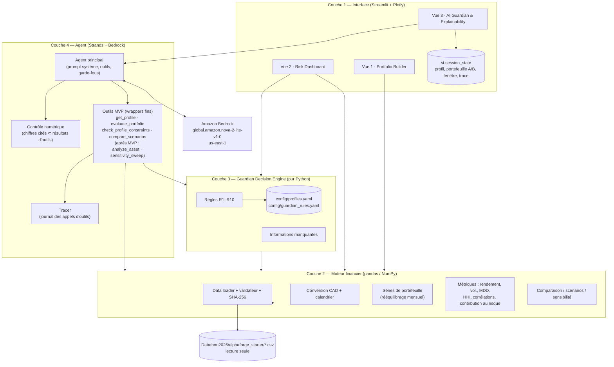

# ARCHITECTURE — Investment Guardian

Statut : **conception, non implémentée**. Étiquettes : **[OFFICIEL]**, **[CHOIX]**, **[À VÉRIFIER]** (à tester en phase 0).

## 1. Principes

1. **Le LLM ne calcule rien.** Chaque chiffre vient d'une fonction Python déterministe ; le modèle choisit les outils et rédige.
2. **Le moteur financier et le Guardian Check ne dépendent ni d'AWS ni de Streamlit.** Ils sont testables seuls.
3. **Un seul agent.** Rôle : comprendre la question, appeler les outils, rédiger une explication adaptée au persona. La gouvernance (Guardian Check) est un **mécanisme déterministe**, pas un second agent. L'explicabilité est un **mécanisme de traçage** (journal d'appels + fiche de provenance + contrôle numérique), pas un second modèle. Cela répond à la question officielle « pourquoi cet agent existe-t-il, quelle valeur apporte-t-il ? » [OFFICIEL, diapo 5].
4. **Contrats typés** (dataclasses/Pydantic) entre couches : toute sortie d'outil est un objet structuré qui contient `result`, `provenance`, `assumptions`, `limitations`.
5. **Pas de service AWS superflu.** Seul Bedrock est utilisé dans le MVP.

## 2. Diagramme des composants



*Dépendances autorisées :* L1 → L2/L3/L4 ; L4 → L3/L2 ; L3 → L2 ; **L2 ne connaît personne**. Aucune importation de `boto3`, `strands` ou `streamlit` dans L2 et L3 (vérifiable par un test d'architecture).

## 3. Disposition de dépôt proposée [CHOIX]

```
/workshop (racine du dépôt)
├── *.md                      # documents de conception (présents)
├── Datathon2026/             # sources officielles, intouchées, exclues de git
├── src/guardian/
│   ├── data/                 # loader.py, validation.py, provenance.py
│   ├── finance/              # calendar.py, fx.py, portfolio.py, metrics.py, compare.py, sensitivity.py
│   ├── rules/                # engine.py, models.py, missing_info.py, report.py (rapport déterministe)
│   ├── profiles/             # modèles de profils (chargés depuis la config)
│   ├── agent/                # tools.py, agent.py, tracer.py, numeric_check.py, prompts.py, aws_health.py
│   └── common/               # schémas, erreurs, journalisation
├── app/                      # app.py + pages Streamlit + composants/graphiques
├── config/                   # profiles.yaml, guardian_rules.yaml, presets.yaml, app.yaml
├── tests/                    # unit/, golden/, architecture/
├── traces/                   # exports JSON de sessions réelles (sans secrets)
├── docs/                     # documentation technique, one pager, captures
├── .env.example              # noms de variables seulement, aucune valeur
├── .gitignore                # .env, .venv, data brute, caches
├── pyproject.toml / requirements.txt
└── README.md
```

## 4. Responsabilités et contrats par module

### 4.1 Couche 2 — Moteur financier

| Module | Responsabilité | Entrée → Sortie |
|---|---|---|
| `data.loader` | Lire les 6 CSV, typer, calculer SHA-256, exposer `DataBundle` | chemin → `DataBundle` |
| `data.validation` | Contrôles (doublons, devises, couverture, ordre des dates) ; produit `DataQualityReport` | `DataBundle` → rapport |
| `finance.calendar` | Construire la grille commune (TSX ∩ US) et y échantillonner les cryptos | `DataBundle` → `DateGrid` |
| `finance.fx` | Reporter USDCAD vers l'avant, convertir les prix USD en CAD | `DateGrid` → panel de prix CAD |
| `finance.portfolio` | Valider les poids (≥ 0, Σ=100 %, actifs connus), générer la valeur du portefeuille avec rééquilibrage mensuel (ou sans, option explicite) | `weights, window, params` → `PortfolioSeries` |
| `finance.metrics` | Rendement cumulé/annualisé, vol., MDD, durée sous l'eau, HHI, N effectif, expositions, corrélations, contribution au risque (Euler) | `PortfolioSeries` → `MetricsResult` |
| `finance.compare` | Deux portefeuilles, **même grille**, écarts et résumé neutre | 2 × `Portfolio` → `ComparisonResult` |
| `finance.sensitivity` | Balayage d'un poids, sous-périodes, changement de fenêtre | `Portfolio, param` → `SensitivityResult` |

Toute sortie porte un `Provenance` : `files`, `sha256`, `window_start/end`, `n_obs`, `calendar_policy`, `fx_policy`, `price_field`, `rebalancing`, `annualization_factor`, `transformations[]`, `assumptions[]`, `limitations[]`.

### 4.2 Couche 3 — Guardian Decision Engine

| Module | Responsabilité |
|---|---|
| `rules.models` | `Profile`, `RuleConfig`, `Finding(rule_id, status, measured, threshold, profile_id, formula, message_template_id, evidence)` |
| `rules.engine` | `check(portfolio_metrics, profile, user_intent) -> GuardianReport` ; une fonction pure par règle (R1–R10) |
| `rules.missing_info` | Génère la liste d'informations manquantes à partir du profil et de ce qui n'a pas été saisi |
| `rules.report` | Rapport en texte par gabarits (mode sans AWS) ; chaque phrase est liée à un `Finding` |

Statuts : `OK`, `ATTENTION`, `CONFLIT`, `INFO`. Les seuils viennent de `config/guardian_rules.yaml` (valeur, justification, caractère « heuristique » ; version). Aucune note globale agrégée.

### 4.3 Couche 4 — Agent

- **Outils exposés au modèle.** Quatre en V1 (`get_profile`, `evaluate_portfolio`, `check_profile_constraints`, `compare_scenarios`), avec schémas explicites ; chacun appelle L2/L3 et renvoie un JSON structuré. `evaluate_portfolio` et `check_profile_constraints` acceptent `portfolio` ("A" ou "B") ; `check_profile_constraints` et `get_profile` acceptent un `profile_id` (profil actif par défaut). Le contexte (profil actif, A, B) vient de `SessionContext`, mis à jour par l'interface à chaque exécution ; chaque requête reçoit en plus une note qui indique seulement quels portefeuilles sont définis (aucun poids). Les deux derniers outils de la liste initiale restent après MVP. **Profil par requête** : le profil actif et les profils nommés par l'utilisateur forment l'ensemble `allowed_profiles` reconstruit à chaque requête ; une question qui nomme un profil sans nommer le profil actif déclenche une demande de précision avant tout appel au modèle (`profile_conflict`), et un outil appelé avec un profil non autorisé échoue.

| Outil | Rôle | Paramètres clés | Statut |
|---|---|---|---|
| `get_profile` | Renvoyer le profil actif et ses seuils | `profile_id` | MVP |
| `evaluate_portfolio` | Métriques et provenance du portefeuille courant ou fourni | `weights?, window?` | MVP |
| `check_profile_constraints` | Guardian Check sur un portefeuille pour un profil | `weights?, profile_id` | MVP |
| `compare_scenarios` | Comparer le portefeuille courant à une variante (`set_weight`, `replace`) | `base, changes[]` | MVP |
| `analyze_asset` | Métriques d'un actif (CAD), fenêtre | `ticker, start?, end?` | Après MVP |
| `sensitivity_sweep` | Faire varier le poids d'un actif ; sous-périodes | `ticker, weights_grid, subperiod?` | Après MVP |

- Le **portefeuille courant** est injecté côté serveur (contexte de session) : le modèle n'a pas à retranscrire des poids. Pour « porter Nvidia à 40 % », le modèle appelle `compare_scenarios(changes=[{set_weight: NVDA, 0.40}])` ; la règle de renormalisation (réduction **au prorata** des autres positions) est **appliquée par Python et affichée**, pas décidée par le modèle.
- **Validation des arguments** : tickers parmi l'univers, poids dans [0,1], fenêtre dans la période disponible ; erreur structurée sinon (le modèle voit l'erreur et la reporte, il ne l'invente pas).
- **Prompt système** [CHOIX] : rôle (assistant d'analyse en simulation), obligation d'appeler un outil avant toute affirmation chiffrée, interdiction de prévoir ou de recommander un achat, obligation de distinguer résultats chiffrés / règles / interprétation, obligation de mentionner limites et hypothèses, langue de l'utilisateur (français par défaut), refus des demandes hors périmètre.
- **Tracer** : décorateur autour de chaque outil qui enregistre `tool`, `arguments`, `started_at`, `duration_ms`, `status`, `result_digest` (hash), `provenance_id`. Il fonctionne indépendamment du modèle : le panneau d'explicabilité montre les appels **réellement exécutés**, jamais une description rédigée par le modèle.
- **Contrôle numérique** : extrait les nombres de la réponse, les compare aux nombres présents dans les résultats d'outils (tolérance d'arrondi) ; affiche « N chiffres vérifiés / M non retrouvés ». Mesure d'honnêteté, pas une garantie sémantique.
- **Étiquetage** des sections de la réponse : `Calcul` (provient d'un outil), `Règle` (Guardian Check), `Interprétation IA` (texte généré). La mise en page affiche les chiffres depuis les objets structurés ; le texte généré les reprend.
- **Santé AWS** (`aws_health`) : vérification à la demande (bouton ou premier message), jamais au chargement du module.

## 5. Flux de données

### 5.1 Analyse sans IA (Vues 1 et 2)
```
CSV → loader (SHA-256) → validation → calendrier ∩ → FX report → prix CAD
    → portefeuille (poids, rééquilibrage mensuel) → métriques → Guardian Check → graphiques/cartes
```
### 5.2 Question à l'assistant (Vue 3)
```
Question utilisateur + contexte (profil, portefeuille courant, fenêtre)
 → Agent (Strands) ⇄ Bedrock (Converse stream, Nova 2 Lite)
     boucle : le modèle demande un outil → Python exécute → Tracer enregistre → résultat renvoyé au modèle
 → Réponse finale
 → Contrôle numérique → Interface : réponse + panneau de trace + provenance + limites
```
### 5.3 Scénario « NVDA à 40 % »
`compare_scenarios` → portefeuille B = A avec NVDA 40 % et reste réduit au prorata → métriques A/B sur la **même grille** → Guardian Check pour le profil actif sur A et B → résultat structuré → l'agent explique les écarts sans désigner de gagnant fondé sur le rendement.

## 6. Hypothèses financières du moteur [CHOIX — détail dans DECISIONS.md]
- Prix : `adj_close` ; devise de référence : CAD ; conversion avant calcul des rendements.
- Grille : jours communs TSX ∩ US ; cryptos échantillonnées sur ces dates ; FX reporté vers l'avant.
- Portefeuille : long-only, sans levier, capital initial fictif (par défaut 100 000 CAD), **rééquilibrage mensuel** vers les poids cibles au dernier jour de grille du mois, sans frais ni impôts. Option « sans rééquilibrage » disponible mais jamais mélangée dans une même comparaison.
- Annualisation : facteur observé (≈ 245,6) ; rendement annualisé géométrique ; avertissement si fenêtre < 1 an.
- Volatilité : écart-type des rendements journaliers (log ou simples : **simples**, à confirmer, voir DECISIONS).
- Drawdown : à partir de la valeur du portefeuille ; durée sous l'eau = jours entre le sommet et la récupération (ou fin de période si non récupéré).

## 7. Authentification AWS

- **Chaîne d'identifiants standard de boto3** : variables d'environnement, profil ou rôle ; aucun code d'identification dans le dépôt. Les jetons temporaires du compte d'événement expirent : le message d'erreur doit le dire.
- Configuration lue dans l'environnement : `AWS_REGION` (défaut `us-east-1`), `BEDROCK_MODEL_ID` (défaut `global.amazon.nova-2-lite-v1:0`), `GUARDIAN_MAX_TOKENS`, `GUARDIAN_MAX_TOOL_CALLS`.
- `.env` (si utilisé) est ignoré par git ; `.env.example` ne contient que des noms de variables. Un test vérifie l'absence de motifs de clés AWS dans le dépôt.
- Journaux et traces : jamais d'en-têtes d'authentification, jamais de variables d'environnement.
- Moindre privilège : l'appel requiert uniquement l'invocation du modèle Bedrock. Le compte d'événement est temporaire et ne contient pas de données sensibles.
- **Constat vérifié le 2026-11-14 (phase 0)** : sur cette machine (Linux, `/workshop`), `aws sts get-caller-identity` réussit avec le rôle assumé `WSParticipantRole` (instance EC2) ; `aws configure list` indique des identifiants de type `iam-role` ; région `us-east-1` via l'environnement. Aucune clé d'accès n'est dans les variables d'environnement. Les identifiants peuvent différer d'une session à l'autre : la vérification d'identité doit être refaite à chaque nouvelle session. Aucune clé IAM n'a été créée.

## 8. Communication Python ↔ Strands ↔ Bedrock

- **Strands** fournit la boucle d'agent (modèle ⇄ outils) ; `BedrockModel` est son fournisseur par défaut et s'appuie sur l'API Converse en streaming de Bedrock avec appel d'outils ([documentation Strands, fournisseur Amazon Bedrock](https://strandsagents.com/latest/documentation/docs/user-guide/concepts/model-providers/amazon-bedrock/)).
- Les outils sont des fonctions Python décorées (`@tool`) qui appellent L2/L3 et renvoient des dictionnaires sérialisables.
- Un agent par session Streamlit, conservé dans `st.session_state` ; historique de conversation limité ; limite d'appels d'outils par tour.
- **Points vérifiés en phase 0** : voir §13. Restent à vérifier : mode streaming vs non-streaming dans Streamlit, et nombre maximal d'itérations d'outils.
- Le succès d'un appel AWS CLI **ne valait pas** validation de Strands ; le test de fumée l'a vérifié (§13).

## 9. Gestion des erreurs

| Situation | Détection | Comportement |
|---|---|---|
| Données absentes ou modifiées | SHA-256 / schéma | Blocage avec message ; mention de la version attendue |
| Poids invalides | Validation (Σ≠100 %, négatifs, doublons, actif inconnu) | Message ciblé dans le builder ; l'analyse ne démarre pas |
| Fenêtre trop courte / données insuffisantes | Contrôle n_obs | Résultat marqué « peu fiable » ; annualisation désactivée si < 1 an |
| Jetons AWS expirés (`ExpiredToken…`), absents, accès refusé | Exception boto/Strands | Bandeau explicite ; chat désactivé ; **reste de l'application fonctionnel** |
| Limitation (throttling) / délai dépassé | Exception, durée | Un nouvel essai limité avec temporisation ; puis erreur visible avec identifiant de requête |
| Modèle indisponible / identifiant erroné | Exception | Message avec la région et l'identifiant utilisés |
| Appel d'outil invalide demandé par le modèle | Validation des arguments | Erreur structurée renvoyée au modèle ; visible dans la trace |
| Chiffre non retrouvé dans les outils | Contrôle numérique | Badge d'avertissement ; ne modifie pas la réponse en silence |
| Boucle d'outils excessive | Compteur | Arrêt après N appels avec message |

**Les erreurs d'API ne sont jamais masquées ni remplacées par une réponse préparée.**

## 10. Fonctionnement dégradé sans AWS

| État | Disponible | Indisponible |
|---|---|---|
| Normal | Tout | — |
| AWS inaccessible | Vues 1 et 2 complètes ; Guardian Check ; comparaison ; sensibilité ; **rapport déterministe par gabarits** (étiqueté « Rapport généré par règles, sans IA ») ; export de résultats | Chat, explications générées |
| Mode relecture (P1) | Relecture d'une **session réelle enregistrée** (trace JSON + réponse + date + modèle) ; bandeau permanent : « Enregistrement du JJ-MM-AAAA ; il ne s'agit pas d'une réponse en direct » ; saisie libre désactivée | Nouvelles questions |

Le mode relecture n'est offert que sous forme de fichier de trace réel ; aucune réponse n'est écrite à la main.
Cet état doit aussi servir si le compte AWS est supprimé : le jury peut exécuter le dépôt, voir le moteur, le Guardian Check et la relecture, et comprendre clairement ce qui nécessite AWS.

## 11. Explicabilité observable

| Élément affiché | Origine |
|---|---|
| Valeur, seuil, statut d'un constat | Règle (Python) |
| Métriques, graphiques | Calcul (Python) |
| Outils appelés, arguments, durée, statut | Tracer |
| Fichiers, SHA-256, période, n_obs, politiques calendrier/FX, rééquilibrage | `Provenance` |
| Hypothèses, limites | `Provenance` + règles R10 |
| Texte d'interprétation | Modèle, étiqueté comme tel |
| Chiffres vérifiés | Contrôle numérique |
| *Non affiché* | Raisonnement interne du modèle (conforme au cadre officiel, §0.6 de PROJECT_SPEC) |

**Exemple de chaîne conclusion → données** (à inclure dans la doc officielle) : « NVDA 40 % = Conflit R1 pour Robert » → `check_profile_constraints` (appel #2, arguments, durée) → `Finding R1 : 40 % > 20 %` → `config/guardian_rules.yaml v1, R1.robert.conflict = 0,20` → métriques calculées sur `prices_daily.csv` (SHA-256 …) du 2021-11-12 au 2026-11-12.

## 12. Choix techniques et alternatives écartées

| Sujet | Choix | Alternative écartée | Raison |
|---|---|---|---|
| Agents | 1 agent + moteur de règles + tracer | Multi-agents (gouvernance, explicabilité) | Complexité décorative ; la gouvernance déterministe est plus testable ; critère officiel : clarté du rôle |
| Données | CSV locaux en mémoire | Base de données / S3 / Athena | 40 000 lignes ; aucun besoin ; ajoute des dépendances et de la fragilité |
| Hébergement | Local (Streamlit) | EC2/App Runner/ECS | Compte temporaire, coût et temps ; non nécessaire à la contribution AWS |
| Orchestration LLM | Strands (imposé par le brief) | LangChain | Intégration native Bedrock, simple ; choix du participant |
| Garde-fous | Règles Python + prompt + contrôle numérique | Bedrock Guardrails | Nécessiterait de créer une ressource AWS ; envisager en P2 seulement si temps et valeur démontrée |
| Persistance | Fichiers JSON locaux (traces, exports) | DynamoDB | Pas de besoin |
| Interface | Streamlit + Plotly | Dash, React | Retenu par le brief ; plus rapide en solo |

**Alternative plus simple considérée** : une seule page Streamlit. Rejetée : trois vues restent plus lisibles en démo, et le coût est faible avec `st.tabs` ou des pages.

## 13. Résultats de la phase 0 (2026-11-14)

| Vérification | Résultat |
|---|---|
| Identité AWS | `WSParticipantRole` (rôle d'instance), compte du Datathon, région `us-east-1` ; aucun secret affiché |
| Python | Python 3.9.25 système : insuffisant. **Python 3.11.18 via `uv`** dans `/workshop/.venv` |
| Paquets | `strands-agents 1.65.0`, `boto3 1.44.3`, `botocore 1.44.3` |
| `BedrockModel(model_id="global.amazon.nova-2-lite-v1:0", region_name="us-east-1")` | **Fonctionne tel quel**. Réponse simple en 0,6 s (68 jetons en entrée, 29 en sortie) |
| Appel d'outil réel | **Fonctionne** : l'agent a appelé `toy_weight_sum` avec `{"NVDA": 40, "XBB.TO": 35, "XIU.TO": 25}` ; 1,3 s, 2 116 jetons en entrée, 100 en sortie |
| Trace | Notre décorateur a enregistré nom, arguments, statut et durée ; `AgentResult.metrics.tool_metrics` du SDK a aussi listé l'outil |

**Incident 1 — signature masquée.** Au premier essai, le décorateur de traçage sans `functools.wraps` a exposé la signature `(*a, **kw)` ; Strands a généré un schéma erroné, et le modèle a appelé l'outil avec les arguments `a` et `kw`. **Règle : tout décorateur d'outil utilise `functools.wraps`**, et un test vérifie que le schéma généré contient les vrais paramètres.

**Incident 2 — le modèle contourne un outil en échec.** Après deux erreurs d'outil, le modèle a calculé lui-même la somme et répondu comme si de rien n'était (en écrivant « je vais procéder directement au calcul »). Pour un produit dont la promesse est « le modèle ne calcule rien », c'est un risque réel. Mesures : (a) prompt système exigeant de signaler un échec d'outil au lieu de calculer ; (b) la trace affiche le statut `error` ; (c) les chiffres de l'interface viennent des objets d'outils, pas du texte du modèle ; (d) le contrôle numérique automatique (après MVP) détecterait un chiffre absent des résultats.

**Limites du test** : un seul modèle, un outil jouet, peu de variabilité observée (température 0). Le comportement avec des schémas plus riches (`compare_scenarios`) sera à retester dès la tranche verticale. Le script est dans `scratch/smoke_strands.py` (ignoré par git).

## 14. Couche d'explications V2 (`src/guardian/explain/`)

Aucune dépendance à Streamlit, à AWS ou à l'IA. Elle transforme les résultats du moteur et du Guardian Check en texte :

| Module | Rôle |
|---|---|
| `cards.py` | Cartes Guardian : problème, chiffre, pourquoi pour ce profil, niveau de vigilance, comment c'est calculé, limites, détails techniques |
| `summary.py` | Résumé prioritaire : regroupement des règles corrélées en trois thèmes, comptage fidèle |
| `compare_plain.py` | Compromis A/B en phrases avec valeurs exactes, sans verdict |
| `trace_view.py` | Niveau 1 de l'explicabilité : phrases décrivant uniquement les appels d'outils réellement journalisés |
| `glossary.py`, `format.py` | Termes, info-bulles, formats français (virgule, dates) |

`app/components.py` ne contient que de l'affichage. Le bouton « Explique-moi mes risques avec l'IA » appelle `GuardianAgent.ask(question, task=…, required_tools=…, kind="explain_risks")` : même agent, même verrou, même journal ; les outils obligatoires sont vérifiés après coup.

## 15. Module ESG et profil Mateo (V3)

```
config/esg_sources.yaml ──► esg/data.py (validation : provenance complète, tickers connus, justifications)
                                   │
profil (esg_preferences) ──────────┼──► esg/engine.py : evaluate_esg() ──► EsgReport (états, couverture en poids, exposition par ligne / FNB, sources, incertitudes)
poids du portefeuille ─────────────┘                                          │
                                                                              ├──► explain/esg_view.py ──► section « Mes préférences ESG » (Streamlit)
                                                                              └──► outil check_esg_preferences ──► agent (même agent, mêmes garde-fous)
```

- Le module ESG est **séparé** du Guardian Check financier : aucune dépendance entre les deux, aucun score commun. Il ne s'applique qu'aux profils ayant des `esg_preferences` (Mateo) ; sinon il retourne « non applicable pour ce profil ».
- Cinq outils pour l'agent : `get_profile`, `evaluate_portfolio`, `check_profile_constraints`, `compare_scenarios`, `check_esg_preferences`. Une question sur l'ESG exige que ce dernier ait réussi dans la requête (`asks_about_esg`), sinon la réponse est retenue.
- Contrôle de cohérence des pourcentages (`unmatched_percentages`) : avertissement visible si un pourcentage du texte ne figure dans aucun résultat d'outil de la requête ; ne détecte pas une coïncidence numérique.
- Trace : `data_refs` des enregistrements de `check_esg_preferences` contient les sources ESG (identifiant, date de consultation, URL) et la version des données ; le niveau 1 de l'explicabilité décrit l'appel et les sources en français simple, le niveau 2 conserve le JSON complet.
- **V3.1.** L'état `COMPLEMENTARY` (relevance « indirect ») sépare l'information complémentaire (ex. observation de gouvernance) du critère déclaré ; `EsgReport.categories` regroupe par décision × dimension × pertinence, chacune avec son poids, sans addition. `explain/funds.py::fund_exposure` ajoute le contexte FNB aux sorties d'outils (`fund_exposure`) et aux cartes R1/R7 (`Card.note`), sans toucher au moteur financier.
